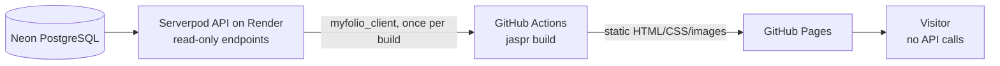

# MyFolio

Personal portfolio, all in Dart. The public site is a statically generated [Jaspr](https://jaspr.site) site. Content lives in PostgreSQL (Neon) behind a [Serverpod](https://docs.serverpod.dev) API and is fetched once per build, so visitors get instant, crawlable HTML and never wait for the API to wake up.

**Live site:** [https://abhicodebugger.github.io/my_folio/](https://abhicodebugger.github.io/my_folio/)  
**API:** `https://my-folio-a91r.onrender.com`

## Monorepo structure

| Package | Path | Purpose |
|---------|------|---------|
| `myfolio_web` | [myfolio_web/](myfolio_web/) | **Public site** — Jaspr static site, built in CI and deployed to GitHub Pages |
| `myfolio_server` | [myfolio_server/](myfolio_server/) | Serverpod 3.4.5 server — read-only content API, Postgres, migrations, seeding |
| `myfolio_client` | [myfolio_client/](myfolio_client/) | Generated protocol client used by the site build |



## Features

- Single-scroll, recruiter-focused page: hero, impact metrics, case studies, experience timeline, expertise, education, "how this site is built", contact
- Static pre-rendering: full content in the HTML, works without JavaScript, no runtime backend dependency
- SEO and sharing: meta description, canonical, Open Graph/Twitter card image, JSON-LD `Person`, `robots.txt`, `sitemap.xml`
- Light/dark theme (follows the OS, toggle persists) and reduced-motion-aware scroll reveal
- Read-only public API; content is seeded server-side (no public write endpoints)

## Prerequisites

- Dart SDK **3.10+** (for `myfolio_web`; the server needs 3.8+) and the Jaspr CLI (`dart pub global activate jaspr_cli 0.23.5`)
- Docker (local Postgres and Redis via [myfolio_server/docker-compose.yaml](myfolio_server/docker-compose.yaml))
- [Serverpod CLI](https://docs.serverpod.dev) (for `serverpod generate` after model or endpoint changes)

## Local development

### 1. Start the backend

```bash
cd myfolio_server
docker compose up --build -d
dart pub get
dart bin/main.dart --apply-migrations
```

Postgres runs on port **8090**, Redis on **8091**. The API is available at `http://localhost:8080`.

Database credentials are configured in [myfolio_server/config/development.yaml](myfolio_server/config/development.yaml) and [myfolio_server/config/passwords.yaml](myfolio_server/config/passwords.yaml) (not committed — copy from your team or Serverpod setup).

To stop services:

```bash
docker compose stop
```

### Seeding content

Portfolio content is seeded by an operator-only command, never over the public API. It is idempotent: a table that already has rows is left untouched, so it is safe to re-run.

```bash
cd myfolio_server
dart bin/seed.dart --mode development --apply-migrations   # local docker DB
dart bin/seed.dart --mode production                       # Neon (needs prod passwords.yaml)
```

Stop any locally running server first, since the command briefly binds the same ports. After the first seed, edit content directly in the database.

The public API is read-only: `portfolio.get*`, `user.getUser` and `file.getResumeUrl`. The former `create*` seed methods and `file.getUploadUrl` were removed, and `User.phoneNumber` is server-only (not returned by `getUser`).

### 2. Run the site

```bash
cd myfolio_web
dart pub get
jaspr serve --port 8085 --dart-define=API_URL=http://localhost:8080/
```

Leave out `API_URL` to render production content. See [myfolio_web/README.md](myfolio_web/README.md) for where the copy and styles live.

### Regenerate the client after server changes

When you add or modify Serverpod models (`.spy` files) or endpoints:

```bash
cd myfolio_server
serverpod generate
```

## Build and deploy

### Production site build

Matches the [deploy workflow](.github/workflows/deploy.yml):

```bash
cd myfolio_web
jaspr build --dart-define=API_URL=https://my-folio-a91r.onrender.com
dart run tool/check_links.dart build/jaspr /my_folio/
```

Output is in `myfolio_web/build/jaspr/`. The build retries the API for up to 3 minutes while Render wakes up. If content can't be fetched, or the profile is missing, it fails and nothing is published, so the live site keeps the last good deploy.

### Updating content

1. Edit the rows in the Neon database (or seed a fresh database with `dart bin/seed.dart`).
2. Run the **Build and Deploy Portfolio Site** workflow manually (Actions → *Run workflow*), or wait for the daily 03:00 UTC build.

Copy that isn't in the database (positioning line, metrics, project images) lives in [myfolio_web/lib/content/site_config.dart](myfolio_web/lib/content/site_config.dart) and deploys on push.

### Rollback

The site is a static artifact on the `gh-pages` branch. To roll back, revert the offending commit on `main`, or re-run an earlier successful deploy workflow run. Server changes deploy independently on Render.

### Server deployment

The server Docker image is defined in [myfolio_server/Dockerfile](myfolio_server/Dockerfile). It applies database migrations on startup (`--apply-migrations`).

### CI/CD

| Workflow | Trigger | What it does |
|----------|---------|--------------|
| [analyze.yml](.github/workflows/analyze.yml) | push/PR to `main` | Dart analyze on `myfolio_server` and `myfolio_web` |
| [format.yml](.github/workflows/format.yml) | push/PR to `main` | Dart format check on `myfolio_server` and `myfolio_web` |
| [tests.yml](.github/workflows/tests.yml) | push/PR to `main` | Server integration tests (Docker Postgres/Redis) and site unit tests |
| [deploy.yml](.github/workflows/deploy.yml) | push to `main`, manual, daily 03:00 UTC | Jaspr static build (content fetched from the API) → link check → GitHub Pages |

## Testing

```bash
# Server integration tests (requires Docker)
cd myfolio_server
docker compose up -d
dart pub get
dart test
docker compose down -v

# Site unit tests (config, content loader)
cd myfolio_web
dart test
```

CI runs both suites.

## Project layout

```
my_folio/
├── myfolio_web/         # Public Jaspr static site
│   ├── lib/content/     # site config + build-time content loader
│   ├── lib/components/  # page sections, head/SEO, @client widgets
│   ├── web/             # images, font, robots.txt, sitemap.xml
│   └── tool/            # check_links.dart
│   ├── lib/
│   │   ├── bootstrap.dart
│   │   ├── config/      # environment / API URL
│   │   ├── providers/   # UserProvider, ThemeProvider
│   │   ├── screens/     # mobile, tablet, desktop layouts
│   │   └── widgets/     # tab content and shared UI
│   └── test/
├── myfolio_server/      # Serverpod server
│   ├── lib/src/endpoints/
│   ├── lib/src/models/  # .spy model definitions
│   ├── lib/src/seed/    # idempotent content seed (bin/seed.dart)
│   └── migrations/
├── myfolio_client/      # Generated protocol client
└── .github/workflows/   # CI/CD
```

## Related docs

- [Serverpod documentation](https://docs.serverpod.dev) — framework reference
- Repository: [https://github.com/AbhiCodebugger/my_folio](https://github.com/AbhiCodebugger/my_folio)
